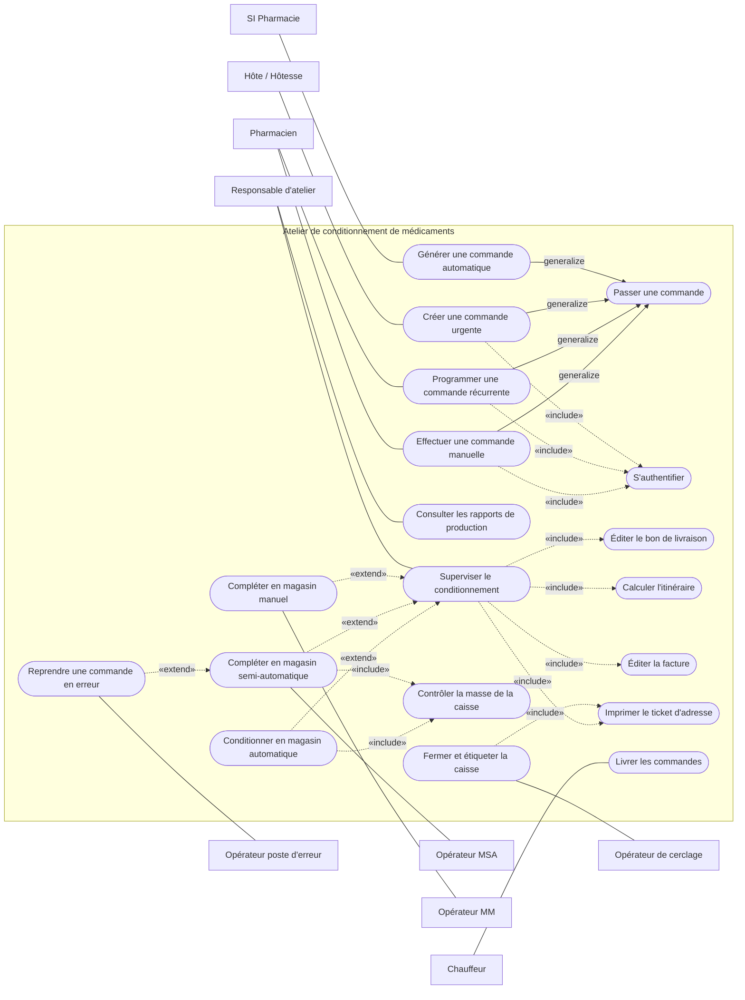

# R3.03 Analyse — Projet Atelier de conditionnement de médicaments

## Séance 1 : Analyse du système

- **Équipe** : Nathan Chaignon, Clément Bazin *(compléter avec les autres membres du groupe)*
- **Fichier StarUML associé** : [`uml/atelier_conditionnement.mdj`](../uml/atelier_conditionnement.mdj)
- **Référence** : Dossier Technique *Atelier de conditionnement de médicaments* (E. Porcq, V2.4)

---

## 5-1) Diagramme de cas d'utilisation (DCU)

Le diagramme complet au format StarUML se trouve dans [`uml/atelier_conditionnement.mdj`](../uml/atelier_conditionnement.mdj) (modèle **`1) Cas d'utilisation`** → **`DCU - Atelier de conditionnement`**).

### Choix de modélisation (conformément aux règles du cours)

- **Bord du système** : `Atelier de conditionnement de médicaments`. Tous les acteurs sont placés **à l'extérieur** de ce bord.
- **Acteurs (rôles extérieurs au système)** :
  - `Pharmacien` : saisit des commandes manuelles et programme des commandes récurrentes sur l'application Web.
  - `Hôte / Hôtesse` : reçoit les appels téléphoniques des pharmaciens et crée les commandes urgentes en tête de file.
  - `SI Pharmacie` : système informatique de la pharmacie transmettant les sorties de stock pour déclencher les commandes automatiques.
  - `Responsable d'atelier` : supervise le processus de conditionnement et consulte les rapports de production.
  - `Opérateur MSA` : vérifie la caisse à l'aide du bon de livraison (BL) et la complète au magasin semi-automatique.
  - `Opérateur poste d'erreur` : reprend intégralement une commande depuis le début après deux pesées non conformes en MSA.
  - `Opérateur MM` : complète la caisse au magasin manuel pour les produits complexes (frigorifiques, fragiles, encombrants).
  - `Opérateur de cerclage` : place le ticket d'adresse sur le couvercle et ferme la caisse avec un anneau (poste COU).
  - `Chauffeur` : récupère les caisses sur la rampe de livraison (RAM) et assure la livraison vers les pharmacies.
  - *Remarque* : les équipements internes (caisses, convoyeurs, balances, serveurs, API, imprimantes) font partie du système et ne sont donc **pas** modélisés comme acteurs.
- **Cas d'utilisation (19 cas ≥ 10 requis)** : tous nommés avec un **verbe d'action à l'infinitif + complément** (test : *« L'acteur peut \<cas\> »*).
- **Relations utilisées** :
  - **Généralisation (`generalize`)** : les 4 modes de commande (`Effectuer une commande manuelle`, `Programmer une commande récurrente`, `Créer une commande urgente`, `Générer une commande automatique`) spécialisent le cas abstrait `Passer une commande`.
  - **Inclusions (`«include»` — nécessité obligatoire)** :
    - `Effectuer une commande manuelle`, `Programmer une commande récurrente`, `Créer une commande urgente` ──`«include»`──▶ `S'authentifier`
    - `Superviser le conditionnement` ──`«include»`──▶ `Éditer le bon de livraison`, `Calculer l'itinéraire`, `Éditer la facture`, `Imprimer le ticket d'adresse`
    - `Conditionner en magasin automatique` et `Compléter en magasin semi-automatique` ──`«include»`──▶ `Contrôler la masse de la caisse`
    - `Fermer et étiqueter la caisse` ──`«include»`──▶ `Imprimer le ticket d'adresse`
  - **Extensions (`«extend»` — enrichissement optionnel)** :
    - `Conditionner en magasin automatique` ──`«extend»`──▶ `Superviser le conditionnement` *(selon le type de produits de la commande)*
    - `Compléter en magasin semi-automatique` ──`«extend»`──▶ `Superviser le conditionnement` *(si produits spécifiques ou erreur de pesée en MA)*
    - `Compléter en magasin manuel` ──`«extend»`──▶ `Superviser le conditionnement` *(si produits frigorifiques, fragiles ou encombrants)*
    - `Reprendre une commande en erreur` ──`«extend»`──▶ `Compléter en magasin semi-automatique` *(uniquement si le poids reste non conforme après 2 passages en MSA)*
  - **Associations acteur–cas** : traits simples sans flèche.

### Aperçu schématique (Mermaid)

---

## 5-2) Liste des objets physiques (matériels et informationnels) de l'atelier

Les objets physiques regroupent l'ensemble des éléments **matériels** et **informationnels** présents dans l'atelier et son environnement direct, classés par **secteur / catégorie**.

### 1. Secteur Commandes et Gestion (amont)

| Nature | Objet physique | Description / Détails issus du dossier technique |
| --- | --- | --- |
| Matériel | Téléphone | Permet au pharmacien d'appeler une hôtesse pour passer une commande urgente |
| Matériel | Poste / navigateur Web du pharmacien | Accès à l'application Web de commande manuelle et récurrente |
| Matériel | Système informatique de la pharmacie | Enregistre les sorties de stock et déclenche les commandes automatiques |
| Informationnel | Commande | Demande d'approvisionnement d'une pharmacie (`urgente`, `manuelle`, `récurrente`, `automatique`) |
| Informationnel | Pharmacie (officine) | Client destinataire (nom, adresse de livraison, coordonnées) |
| Informationnel | Base `ACM_Commande` | Stocke dynamiquement les commandes en attente de traitement |
| Informationnel | Base `ACM_MedicamentAtelier` | Référentiel des médicaments du grossiste (CIP, désignation, localisation, masse, prix) |
| Informationnel | Base `ACM_MagasinAuto` | Liste des médicaments affectés aux éjecteurs des magasins automatiques |

### 2. Secteur Lancement et Convoyage (acheminement des caisses)

| Nature | Objet physique | Description / Détails issus du dossier technique |
| --- | --- | --- |
| Matériel | Stock de caisses vides | Réserve de bacs vides en amont du poste de lancement |
| Matériel | Caisse (bac) | Conteneur plastique (bleu/vert) associé à une seule commande, identifié par un code-barre unique |
| Matériel | Convoyeur principal | Succession de tapis roulants (parfois débrayables en LCT, MAx, ADR, FAC, COU), découpés en tronçons et intersections |
| Matériel | Convoyeurs parallèles | Voies d'attente de remplissage dans les magasins semi-automatiques (MSA1 à MSA8) |
| Matériel | Aiguillages (`A1` à `A19`) | 19 aiguillages orientant les caisses selon les ordres transmis à l'API |
| Matériel | Lecteurs code-barre (`LCB1` à `LCB22`) | 22 lecteurs identifiant les caisses aux points stratégiques (`LCB1` relié au poste de lancement, les autres à l'API) |
| Matériel | Balances (`B1` à `B12`) | 12 balances reliées en RS485/Modbus au poste de pesée (`B1` tare, `B2`–`B4` sortie MA1–MA3, `B5`–`B12` en MSA1–MSA8) |
| Matériel | Imprimante du poste de lancement (LCT) | Imprime le bon de livraison et le dépose automatiquement dans la caisse |
| Informationnel | Code-barre de caisse | Identifiant unique lu par les LCB pour suivre la caisse |
| Informationnel | Bon de livraison (BL) | Document imprimé contenant : numéro unique, codes CIP, quantités, désignations commerciales, codes géographiques, masses unitaires, prix unitaires |
| Informationnel | Itinéraire de la caisse | Séquence de positions/tronçons, numéros de LCB, positions d'aiguillage (`N°_pos`) et poids attendus (cf. `itineraire.ods`), stocké sur le serveur de gestion |
| Informationnel | Mesure de masse (tare / pesée) | Poids à vide (tare) et poids mesurés successivement pour vérifier la conformité |

### 3. Secteur Magasins automatiques (`MA1`, `MA2`, `MA3`)

| Nature | Objet physique | Description / Détails issus du dossier technique |
| --- | --- | --- |
| Matériel | Magasins automatiques (`MA1` à `MA3`) | 3 unités automatisées couvrant ~85 % des produits |
| Matériel | Tapis roulant de magasin auto | Tapis de 60 m avançant de 0,8 à 1,2 m/s portant les tas jusqu'à la caisse en bout de tapis |
| Matériel | Tunnel | Structure couvrant le tapis et supportant les rails |
| Matériel | Rails d'approvisionnement (goulottes) | Glissières contenant les réserves de boîtes de médicaments |
| Matériel | Éjecteurs (40 par magasin : 2 × 20) | Actionneurs pilotés en TOR (collecteur ouvert) faisant tomber de 1 à 3 boîtes par impulsion |
| Matériel | Cellules photoélectriques TOR | 1 capteur par éjecteur vérifiant la chute effective des boîtes |
| Matériel | Moteur à courant continu & régulateur de tension | Entraîne le tapis roulant sous contrôle du superviseur |
| Matériel | Codeur optique incrémental | Fournit les impulsions de position précise du tapis et des tas |
| Matériel | Boîtes de médicaments | Produits pharmaceutiques stockés dans les rails puis regroupés en tas |
| Informationnel | Tas de médicaments | Ensemble de boîtes sur le tapis correspondant à une commande (position courante, état, codes CIP, quantités restantes) |
| Informationnel | File de commandes du magasin | Liste des commandes en attente de préparation sur un tapis automatique |
| Informationnel | Réserve / stock des goulottes | Nombre de boîtes restantes et code CIP associé à chaque éjecteur |

### 4. Secteur Magasins semi-automatiques, Magasin manuel et Poste d'erreur

| Nature | Objet physique | Description / Détails issus du dossier technique |
| --- | --- | --- |
| Matériel | Magasins semi-automatiques (`MSA1` à `MSA8`) | 8 postes de complétion manuelle assistée et de reprise après anomalie en MA |
| Matériel | Magasin manuel (`MM`) | Zone dédiée aux produits complexes sans contrôle pondéral automatisé |
| Matériel | Équipements de stockage spécifique (réfrigérateur, rayonnages) | Conservation des vaccins (chaîne du froid), produits fragiles ou encombrants |
| Matériel | Poste d'erreur | Poste de reprise intégrale d'une commande après 2 échecs de pesée en MSA |
| Matériel | Médicaments particuliers et matériels médicaux | Produits frigorifiques, encombrants, fragiles ou de forme/poids atypiques |
| Informationnel | Compteur d'essais / passages en MSA | Permet de rediriger la caisse vers le poste d'erreur après 2 pesées non conformes |
| Informationnel | Statut de conformité | Indique si la masse mesurée correspond à la masse attendue |

### 5. Secteur Finalisation et Expédition (`ADR`, `FAC`, `COU`, `RAM`)

| Nature | Objet physique | Description / Détails issus du dossier technique |
| --- | --- | --- |
| Matériel | Poste d'édition d'adresse (`ADR`) & imprimante | Imprime le ticket d'adresse de destination qui tombe dans la caisse |
| Matériel | Poste de facturation (`FAC`) & imprimante | Imprime la facture qui tombe automatiquement dans la caisse |
| Matériel | Poste de cerclage de couvercle (`COU`) | Poste où l'opérateur pose le ticket d'adresse sur le couvercle et ferme la caisse |
| Matériel | Couvercles et anneaux de cerclage | Consommables servant à fermer et sceller chaque caisse |
| Matériel | Rampe de livraison (`RAM`) | Quai final où arrivent les caisses prêtes à être chargées |
| Matériel | Camionnettes / Camions de livraison | Véhicules utilisés par les chauffeurs pour livrer les pharmacies |
| Informationnel | Ticket d'adresse | Étiquette portant l'adresse de la pharmacie destinataire |
| Informationnel | Facture | Document comptable joint à la commande dans la caisse |
| Informationnel | Rapports de production | Journaux et bilans d'activité sauvegardés sur le volume NFS |

### 6. Secteur Infrastructure informatique et réseaux (matériels présents dans l'atelier)

> *Note : ces ordinateurs et automates sont bien des **objets physiques matériels** présents dans l'atelier, mais ils ne constituent **pas** des objets informatiques (classes métier) — ils seront modélisés comme nœuds dans le diagramme de déploiement (Séance 2).*

| Nature | Objet physique | Spécification technique |
| --- | --- | --- |
| Matériel | Serveur physique Gigabyte G492-Z51 | Debian 12.5, RAID 5 (200 To), Ethernet — héberge les 2 VM : **Serveur de gestion** et **Serveur de production** (volume NFS + serveur Web) |
| Matériel | Superviseur | PC industriel fanless Galium sous OS9 v6.0, carte Ethernet, sorties tension variables, E/S 6 bits et 16 bits |
| Matériel | Poste de lancement (`LCT`) | Dell Optiplex 3020 SFF sous Windows 11 |
| Matériel | Poste de pesée | Dell Optiplex 3020 SFF sous Ubuntu 20.4, carte Ethernet, interface RS485 |
| Matériel | Automates Programmables Industriels (`API`) | GE FANUC IC655CPU500H (lecture des LCB, pilotage des aiguillages et convoyeurs) |
| Matériel | Réseau Ethernet & bus RS485 / liaisons TOR | Supports de communication (TCP/IP, NFS, Modbus sur RS485, liaisons TOR/analogiques) |

### 7. Intervenants humains

- Pharmaciens (clients)
- Hôte·sses (saisie des commandes urgentes par téléphone)
- Opérateurs de magasin semi-automatique (MSA), de magasin manuel (MM), du poste d'erreur et du poste de cerclage (COU)
- Chauffeurs / Livreurs
- Responsable d'atelier

---

## 5-3) Liste déduite des objets informatiques de l'atelier

> **Principe** : Les **objets informatiques** sont les entités logicielles (futures classes du diagramme de classes) manipulées en mémoire par les programmes de l'atelier pour représenter les données métier, les documents numériques et l'image logicielle des capteurs/actionneurs pilotés. **Ce ne sont pas les ordinateurs** (qui hébergeront ces objets à la question 5-4).

### A. Gestion des commandes, du catalogue et des documents

| Objet informatique | Déduit de (5-2) | Rôle logiciel envisagé |
| --- | --- | --- |
| **`Pharmacie`** | Pharmacie / Officine | Stocke l'identifiant, la raison sociale et l'adresse de livraison |
| **`Commande`** | Commande + base `ACM_Commande` | Représente une commande client (numéro, date, type/priorité : urgente, manuelle, récurrente, automatique, état) |
| **`LigneCommande`** | Liste des médicaments commandés | Associe un `Medicament` et une quantité demandée au sein d'une `Commande` |
| **`Medicament`** | Boîte de médicament + `ACM_MedicamentAtelier` | Regroupe code CIP, désignation commerciale, code géographique, masse unitaire, prix unitaire, type de conditionnement (MA/MSA/MM) |
| **`BonDeLivraison`** (`BL`) | Bon de livraison | Objet généré par le serveur de production avec numéro unique, lignes produits, localisations, masses et prix |
| **`Facture`** | Facture | Contient le détail chiffré et le montant total imprimé au poste FAC |
| **`TicketAdresse`** | Ticket d'adresse | Contient les informations de destination imprimées au poste ADR |
| **`RapportProduction`** | Rapports de production | Enregistre les statistiques, historiques de production et anomalies sur le volume NFS |

### B. Suivi des caisses et pilotage de l'atelier (convoyage et pesée)

| Objet informatique | Déduit de (5-2) | Rôle logiciel envisagé |
| --- | --- | --- |
| **`Caisse`** | Caisse + code-barre + pesées | Représente une caisse en circulation : code-barre unique, tare, masse courante, masse attendue, état, compteur de passages MSA, association à la commande/BL |
| **`Itineraire`** | Itinéraire de la caisse (`itineraire.ods`) | Suite ordonnée d'étapes calculées pour guider une caisse à travers l'atelier |
| **`EtapeItineraire`** | Colonnes de `itineraire.ods` | Décrit une position (`numPos`, `positionConv`, numéro de LCB, aiguillage et position cible, poids prévu) |
| **`LecteurCodeBarre`** (`LCB`) | Lecteurs `LCB1` à `LCB22` | Image logicielle d'un lecteur : identifiant, emplacement, détection/lecture du code-barre |
| **`Aiguillage`** | Aiguillages `A1` à `A19` | Image logicielle d'un aiguillage : numéro, état/position, commande d'orientation |
| **`Convoyeur`** | Convoyeurs principaux et parallèles | Représente un tronçon pilotable (identifiant, état marche/arrêt/débrayé, type) |
| **`Balance`** | Balances `B1` à `B12` | Image logicielle d'une balance RS485/Modbus : identifiant, adresse, acquisition de la masse (`peser()`) |

### C. Pilotage des magasins automatiques *(cohérent avec le diagramme fourni page 7)*

| Objet informatique | Déduit de (5-2) | Rôle logiciel envisagé |
| --- | --- | --- |
| **`Magasin`** *(MagasinAutomatique)* | `MA1`, `MA2`, `MA3` + `ACM_MagasinAuto` | Représente un magasin automatique : disponibilité, lecture de code médicament (`lireCode()`), commande d'éjection (`ejecterMedicament()`) |
| **`Ejecteur`** | 40 éjecteurs + cellules photoélectriques + goulottes | Numéro (1..40), code CIP, stock restant dans la goulotte, état de la cellule photoélectrique, commande TOR |
| **`TapisRoulant`** | Tapis roulant + moteur CC | Pilote l'avancement du tapis, la création des tas et la gestion des commandes (`gererCommandes()`, `creerTas()`) |
| **`Tas`** | Tas de médicaments sur le tapis | Position courante, état, codes CIP et quantités restantes à déposer (`majPosition()`) |
| **`FileDeCommande`** | File de commandes du magasin | Gère la file FIFO des commandes à traiter par un magasin auto (`lireNombre()`, `lireCommandeSuivante()`) |
| **`Codeur`** | Codeur optique incrémental | Gère la synchronisation par impulsions entre deux positions du tapis (`attendreSynchro()`) |

### D. Postes spécialisés et interfaces logicielles

| Objet informatique | Déduit de (5-2) | Rôle logiciel envisagé |
| --- | --- | --- |
| **`PosteSemiAuto`** (`MSA`) | `MSA1` à `MSA8` | Représente un poste semi-automatique (identifiant, disponibilité, association à son LCB, sa balance et son convoyeur parallèle) |
| **`Imprimante`** | Imprimantes LCT, ADR et FAC | Interface logicielle d'impression (BL, ticket d'adresse, facture) |
| **`IHM`** *(Web / Poste)* | Application Web & écrans de saisie/supervision | Interface permettant aux pharmaciens, hôtesses et responsables d'interagir avec le système |

### Objets physiques volontairement exclus de la liste informatique (justifications)

- **Ordinateurs, serveurs et API** (`Serveur de gestion`, `Serveur de production`, `Superviseur`, `Poste de lancement`, `Poste de pesée`, `API`) : ce sont des **nœuds matériels** sur lesquels s'exécutent les objets informatiques (traités en 5-4 et dans le diagramme de déploiement).
- **Éléments mécaniques passifs ou hors périmètre logiciel** : `tunnel`, `couvercle`, `anneau de cerclage`, `réfrigérateur`, `camionnette`, `téléphone`, `câbles Ethernet / RS485`, `rampe de livraison` (structure physique non pilotée).
- **Personnes physiques** (`Pharmacien`, `Hôte·sse`, `Opérateurs`, `Chauffeur`) : ce sont des **acteurs** externes au logiciel *(seul un éventuel objet `Utilisateur`/`Compte` existe si l'authentification est modélisée)*.
