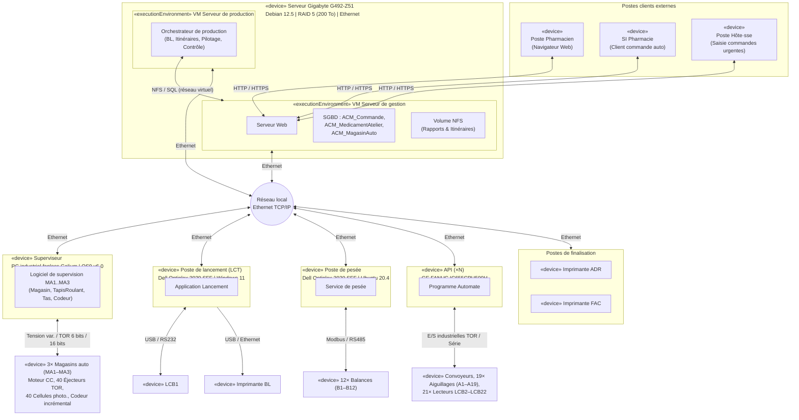
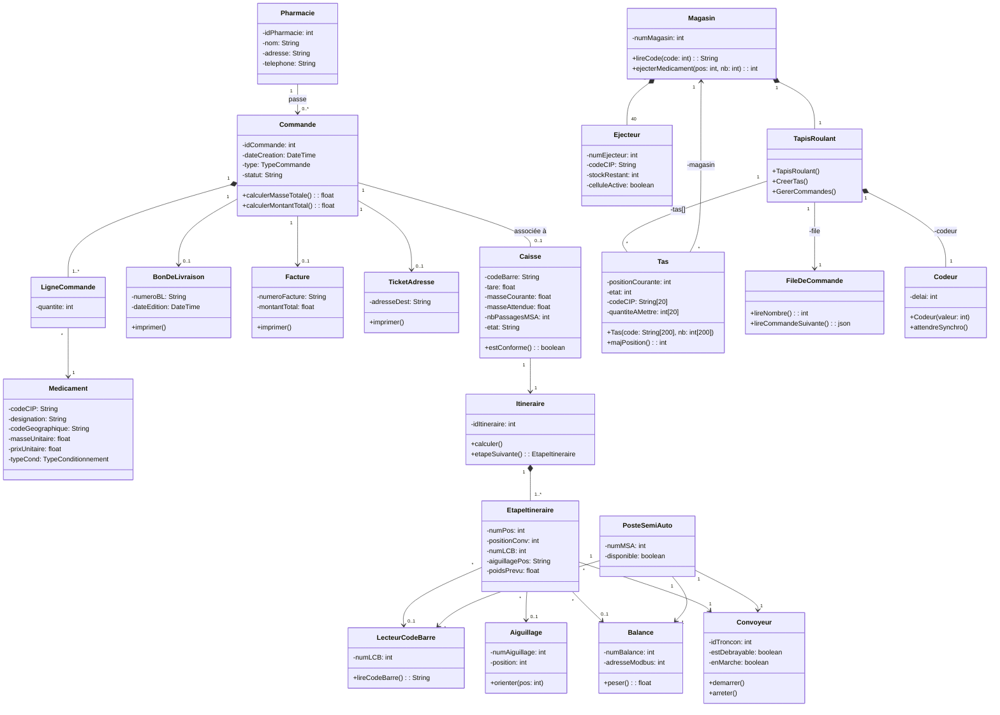

# R3.03 Analyse — Projet Atelier de conditionnement de médicaments

## Séance 2 : Architecture, technologies, déploiement et début du diagramme de classes

- **Équipe** : Nathan Chaignon, Clément Bazin, Paul Maillard *(compléter si besoin)*
- **Fichier StarUML associé** : [`uml/atelier_conditionnement.mdj`](../uml/atelier_conditionnement.mdj)
- **Référence** : Dossier Technique *Atelier de conditionnement de médicaments* (E. Porcq, V2.4) et [Séance 1](seance1_analyse.md)

---

## 5-4) Association des objets informatiques aux ordinateurs de l'atelier

Les objets informatiques identifiés à la question 5-3 sont répartis sur les **6 systèmes informatiques** décrits dans le dossier technique (sections 2.2 et 4.1).

> **Note sur les postes de finalisation (`ADR` et `FAC`)** : Le dossier technique ne mentionne pas de PC dédiés pour `ADR` et `FAC` dans la section 4.1 ; leurs imprimantes et lecteurs (`LCB20`, `LCB21`) sont pilotés via le réseau par le **Serveur de production** (lecture des LCB remontée par l'API, déclenchement de l'impression du `TicketAdresse` et de la `Facture`).

### Répartition par ordinateur / système

| Système informatique | Caractéristiques (Dossier 4.1 & 4.2) | Objets informatiques hébergés / gérés | Rôle principal |
| --- | --- | --- | --- |
| **Serveur de gestion** *(VM sur Gigabyte G492-Z51)* | Debian 12.5, RAID 5 (200 To), serveur Web, volume NFS, Ethernet | `Pharmacie`, `Commande`, `LigneCommande`, `Medicament`, `Itineraire` *(stockage)*, `EtapeItineraire` *(stockage)*, `RapportProduction` *(stockage NFS)*, `IHM` *(application Web & saisie hôtesse)* | Héberge les bases `ACM_Commande`, `ACM_MedicamentAtelier` et `ACM_MagasinAuto`, le serveur Web pour les pharmaciens et le partage NFS (rapports et itinéraires). |
| **Serveur de production** *(VM sur Gigabyte G492-Z51)* | Debian 12.5, client NFS, Ethernet | `BonDeLivraison`, `Itineraire` *(calcul)*, `EtapeItineraire` *(calcul)*, `Caisse`, `Facture`, `TicketAdresse`, `RapportProduction` *(génération)*, `PosteSemiAuto`, `Imprimante` *(ADR, FAC)*, `Commande` *(copie en cours)*, `Medicament` *(consultation)* | **Chef d'orchestre** : lit les commandes en attente, construit les BL, calcule les itinéraires, suit chaque caisse, donne les ordres à l'API, demande les vérifications de masse au poste de pesée, transmet les sous-commandes au Superviseur et déclenche ADR/FAC. |
| **Superviseur** | PC industriel fanless Galium, OS9 v6.0, Ethernet, 3× sorties tension variable, 3× E/S 6 bits, 3× entrées 16 bits | `Magasin`, `Ejecteur`, `TapisRoulant`, `Tas`, `FileDeCommande`, `Codeur` | Pilote les 3 magasins automatiques (`MA1` à `MA3`) en temps réel : synchronise les tapis via les codeurs, gère les files et tas, commande les éjecteurs TOR et contrôle les cellules photoélectriques. Lit `ACM_MagasinAuto` sur le serveur de gestion. |
| **Poste de lancement (`LCT`)** | Dell Optiplex 3020 SFF, Windows 11 *(voir note matérielle ci-dessous)* | `BonDeLivraison` *(réception & impression)*, `Imprimante` *(LCT)*, `LecteurCodeBarre` *(LCB1)*, `Caisse` *(association initiale)*, `IHM` *(écran poste LCT)* | Reçoit le BL du serveur de production, l'imprime et le dépose dans la caisse, lit `LCB1` pour associer le code-barre de la caisse à la commande, et déclenche l'acheminement d'une caisse vide. |
| **Poste de pesée** | Dell Optiplex 3020 SFF, Ubuntu 20.4, Ethernet, interface RS485 (Modbus) | `Balance` *(B1 à B12)* | Interroge les 12 balances sur le bus RS485 (protocole Modbus) à la demande du serveur de production et renvoie les mesures de masse (tare et contrôles pondéraux). |
| **API (Automates Programmables Industriels)** | GE FANUC IC655CPU500H *(plusieurs unités)* | `LecteurCodeBarre` *(LCB2 à LCB22)*, `Aiguillage` *(A1 à A19)*, `Convoyeur` *(tronçons principaux et parallèles)* | Lit dynamiquement les codes-barres `LCB2`–`LCB22`, remonte les identifications au serveur de production et applique les ordres de pilotage sur les aiguillages et convoyeurs. |

### Matrice synthétique Objet ↔ Ordinateur

| Objet informatique | Propriétaire / Exécution principale | Autres systèmes impliqués (lecture / transit) |
| --- | --- | --- |
| `Pharmacie` | Serveur de gestion | Serveur de production (ADR, FAC) |
| `Commande`, `LigneCommande` | Serveur de gestion (`ACM_Commande`) | Serveur de production (traitement) |
| `Medicament` | Serveur de gestion (`ACM_MedicamentAtelier`, `ACM_MagasinAuto`) | Serveur de production (BL, masses), Superviseur (affectation éjecteurs) |
| `BonDeLivraison` (`BL`) | Serveur de production (création) | Poste de lancement (impression & dépôt en caisse) |
| `Facture`, `TicketAdresse` | Serveur de production (génération) | Imprimantes FAC / ADR |
| `RapportProduction` | Serveur de production (génération) | Serveur de gestion (stockage sur volume NFS) |
| `Caisse` | Serveur de production (suivi global) | Poste de lancement (association initiale via `LCB1`) |
| `Itineraire`, `EtapeItineraire` | Serveur de production (calcul & exécution) | Serveur de gestion (archivage sur volume NFS) |
| `PosteSemiAuto` (`MSA1`–`MSA8`) | Serveur de production (routage & compteur d'essais) | — |
| `LecteurCodeBarre` | API (`LCB2`–`LCB22`) et Poste de lancement (`LCB1`) | Serveur de production (réception des lectures) |
| `Aiguillage` (`A1`–`A19`) | API (pilotage physique) | Serveur de production (décision d'orientation) |
| `Convoyeur` | API (pilotage marche/arrêt/débrayage) | Serveur de production (ordres), Poste de lancement (appel caisse vide) |
| `Balance` (`B1`–`B12`) | Poste de pesée (acquisition Modbus/RS485) | Serveur de production (demande de pesée et contrôle) |
| `Magasin`, `Ejecteur`, `TapisRoulant`, `Tas`, `FileDeCommande`, `Codeur` | Superviseur (pilotage temps réel `MA1`–`MA3`) | Serveur de gestion (`ACM_MagasinAuto`), Serveur de production (envoi sous-commandes) |
| `Imprimante` | Poste de lancement (BL) et Serveur de production (ADR, FAC) | — |
| `IHM` | Serveur de gestion (Web / Hôtesse) et Poste de lancement (écran opérateur) | — |

> **Réponse au point d'interrogation du dossier technique (section 4.2 : *« Le poste de lancement ? »*)** :
> Pour assurer ses fonctions, le **Poste de lancement (Dell Optiplex 3020 SFF sous Windows 11)** doit disposer de :
> - **1 carte Ethernet** (communication TCP/IP avec le serveur de production pour recevoir les BL et transmettre l'association code-barre / commande) ;
> - **1 interface série (RS232) ou USB** pour la lecture du lecteur code-barre `LCB1` ;
> - **1 interface USB ou Ethernet** pour l'imprimante de bons de livraison ;
> - **1 interface d'E/S TOR ou liaison réseau vers l'API** pour commander l'acheminement d'une caisse vide depuis le stock de caisses vides.

---

## 5-6) Explications et comparaisons technologiques

### 1. RS232 et RS485

- **RS232** : Norme de liaison série asynchrone **point-à-point** (1 émetteur, 1 récepteur) utilisant des signaux référencés par rapport à une masse commune (asymétrique). Simple à câbler, mais sensible aux parasites électromagnétiques et limitée en distance (~15 m) et en débit.
- **RS485** : Norme de liaison série **différentielle** (paire torsadée `A`/`B`) supportant une topologie **bus multipoint** (jusqu'à 32 nœuds standard, voire plus avec répéteurs). Grâce à la transmission différentielle, elle résiste très bien aux perturbations électromagnétiques industrielles et atteint de longues distances (jusqu'à 1 200 m).

| Critère | RS232 | RS485 |
| --- | --- | --- |
| Topologie | Point-à-point (1 maître – 1 esclave) | Bus multipoint (jusqu'à 32 périphériques sur 1 paire) |
| Type de signal | Asymétrique (référencé à la masse) | Différentiel (paire torsadée) |
| Immunité au bruit | Faible (sensible aux moteurs/variateurs) | Très élevée (adaptée au milieu industriel) |
| Distance maximale | ~15 m | Jusqu'à 1 200 m |
| Débit typique | Jusqu'à 115,2 kbit/s | Jusqu'à 10 Mbit/s (courte distance) |
| Mode | Full-duplex | Half-duplex (2 fils) ou Full-duplex (4 fils) |

- **Justification dans l'atelier** : Le poste de pesée doit interroger **12 balances (`B1` à `B12`)** réparties dans tout l'atelier, à proximité de moteurs électriques (convoyeurs, magasins automatiques). **RS485** permet de relier les 12 balances sur un **unique bus** avec une forte immunité aux parasites et sans limitation de distance, là où RS232 aurait exigé 12 ports série dédiés et des câbles courts.

---

### 2. NFS et SMB

- **NFS (*Network File System*)** : Protocole de partage de fichiers en réseau conçu à l'origine par Sun Microsystems pour les systèmes **Unix/Linux**. Il permet de monter un répertoire distant dans l'arborescence locale de façon transparente et performante.
- **SMB (*Server Message Block* / CIFS)** : Protocole de partage de fichiers (et d'imprimantes) natif de l'écosystème **Windows** (également supporté sous Linux via Samba). Il intègre nativement la gestion des droits Windows (ACL, Active Directory).

| Critère | NFS | SMB |
| --- | --- | --- |
| Écosystème natif | Unix / Linux | Windows (Linux via Samba) |
| Modèle d'intégration | Montage transparent dans l'arborescence POSIX (`/mnt/...`) | Partages réseau (`\\serveur\partage`), gestion fine des ACL Windows |
| Surcharge / Performances | Légère et très performante entre machines Linux | Légèrement plus verbeux (négociation, sessions, chiffrement SMB3) |
| Sécurité native | Historiquement basée sur IP/UID (Kerberos avec NFSv4) | Authentification utilisateur/domaine intégrée + chiffrement natif (SMB 3.x) |

- **Justification dans l'atelier** : Les deux serveurs virtualisés (**Serveur de gestion** et **Serveur de production**) tournent tous les deux sous **Debian 12.5 (Linux)**. **NFS** est donc le choix le plus simple, natif et performant pour permettre au serveur de production d'écrire les rapports de production et les itinéraires sur le stockage du serveur de gestion. *(SMB n'aurait d'intérêt que pour partager des fichiers avec le poste de lancement sous Windows 11.)*

---

### 3. Ethernet et Modbus

> *Attention à ne pas confondre les niveaux OSI* : **Ethernet** (IEEE 802.3) définit les couches basses (physique et liaison de données, couches 1–2) d'un réseau local informatique supportant généralement **TCP/IP**, tandis que **Modbus** est un **protocole applicatif industriel** (couche 7) de type maître-esclave (client-serveur), historiquement transporté sur liaison série **RS485** (Modbus RTU/ASCII) ou encapsulé sur TCP/IP (Modbus TCP).

| Critère | Ethernet (+ TCP/IP) | Modbus (sur RS485 / RTU) |
| --- | --- | --- |
| Couches OSI | Couches 1 et 2 (physique & liaison), couplé à IP/TCP | Couche 7 (applicative), ici sur couche physique RS485 |
| Modèle d'échange | Pair-à-pair / Client-serveur généraliste | Maître-esclave strict (le maître interroge chaque esclave par son adresse) |
| Débit | Très élevé (100 Mbit/s, 1 Gbit/s, 10 Gbit/s) | Modéré (9,6 à 115,2 kbit/s sur RS485) |
| Complexité / Coût matériel | Pile réseau complète (switchs, cartes NIC) | Très léger, peu coûteux, embarquable dans des capteurs/balances simples |
| Déterminisme | Non déterministe par défaut (sauf Ethernet industriel) | Prévisible grâce au scrutation (*polling*) maître-esclave |

- **Justification dans l'atelier** :
  - **Ethernet** relie les équipements informatiques riches (serveurs, superviseur, poste de lancement, poste de pesée, API) qui échangent des volumes de données variés (SQL, NFS, Web, ordres de production).
  - **Modbus sur RS485** est idéal entre le poste de pesée (maître) et les 12 balances (esclaves) : les trames sont minuscules (demande de mesure + retour d'une valeur de masse), les balances industrielles l'intègrent nativement et son coût de câblage est minimal.

---

### 4. Un API (Automate Programmable Industriel) et un PC

- **API (PLC — *Programmable Logic Controller*)** : Calculateur industriel dédié à l'automatisme, conçu pour fonctionner 24h/24 dans des environnements sévères (poussière, vibrations, CEM). Il exécute en boucle un **cycle déterministe** (*lecture des entrées → exécution du programme → écriture des sorties*) avec des temps de réponse garantis.
- **PC (Ordinateur personnel / Serveur)** : Machine polyvalente dotée d'un système d'exploitation multitâche généraliste (Windows, Linux), adaptée au calcul complexe, au stockage de masse, aux bases de données et aux interfaces homme-machine (IHM), mais non déterministe par défaut (sauf OS temps réel spécifique comme OS9 sur le superviseur).

| Critère | API (ex. GE FANUC IC655CPU500H) | PC (ex. Dell Optiplex / Serveur) |
| --- | --- | --- |
| Temps réel / Déterminisme | **Temps réel déterministe** (cycle de scan garanti en ms) | Non déterministe sous OS standard (interruptions, mises à jour, swap) |
| Interfaces matérielles | Cartes d'E/S industrielles natives (TOR 24V, analogiques, bus terrain) | Interfaces informatiques (Ethernet, USB, affichage, stockage) |
| Robustesse / Fiabilité | Très haute (sans ventilateur, plage thermique étendue, redémarrage instantané) | Plus sensible (OS complexe, pièces mobiles, redémarrage lent) |
| Programmation | Langages normalisés IEC 61131-3 (Ladder, Grafcet/SFC, ST) | Langages généralistes (C/C++, Java, Python, SQL, Web) |
| Capacité de calcul / Stockage | Limitée (dédiée au contrôle-commande) | Très élevée (SGBD, 200 To, virtualisation, IHM) |

- **Justification dans l'atelier** : Les **API** assurent la couche réflexe de terrain (lecture temps réel des 21 `LCB`, pilotage immédiat des 19 aiguillages et des convoyeurs sans risque de gel d'OS). Les **PC / serveurs** assurent la logique métier complexe (bases de données, calcul d'itinéraires, serveur Web, impression de BL). Le **Superviseur** fait le pont : c'est un **PC industriel fanless sous OS9** (un **RTOS** — système d'exploitation temps réel) combinant capacité de traitement et réactivité temps réel pour les 3 magasins automatiques.

---

### 5. Codeur optique incrémental et codeur optique absolu

Un **codeur optique** mesure la rotation d'un axe (ici l'entraînement du tapis roulant de 60 m) grâce à un disque percé/codé traversé par un faisceau lumineux.

- **Codeur optique incrémental** : Génère une suite d'**impulsions** électriques proportionnelles au déplacement angulaire (souvent 2 voies en quadrature `A`/`B` pour connaître le sens, plus un top zéro `Z` par tour). Il mesure un déplacement **relatif** : il faut compter les impulsions depuis une référence connue, et la position est perdue en cas de coupure de courant (nécessite une prise d'origine).
- **Codeur optique absolu** : Possède un disque gravé sur plusieurs pistes concentriques codées (généralement en **code Gray** pour éviter les erreurs de transition). À chaque instant, chaque angle correspond à un **mot binaire unique** : la position exacte est connue immédiatement, même après une coupure d'alimentation.

| Critère | Codeur optique incrémental | Codeur optique absolu |
| --- | --- | --- |
| Information fournie | Déplacement relatif (nombre d'impulsions) | Position angulaire exacte (mot binaire / code Gray) |
| Perte d'alimentation | Position perdue → réinitialisation (prise d'origine) nécessaire | Position conservée et lisible immédiatement au redémarrage |
| Nombre de fils / complexité | Faible (voies A, B, Z) | Plus élevé (bus parallèle multi-bits ou liaison série dédiée) |
| Coût | **Économique** | Plus élevé |
| Usage typique | Mesure de vitesse, d'avance pas-à-pas ou de distance parcourue | Positionnement critique de bras robotisés, vannes, axes de machines-outils |

- **Justification dans l'atelier** : Sur le tapis roulant du magasin automatique, on n'a pas besoin de connaître l'angle absolu du rouleau après une coupure : on a uniquement besoin d'une **synchronisation régulière par pas** (*« le tapis a avancé d'une position d'éjecteur »*, cf. `attendreSynchro()` dans la classe `Codeur`). Le **codeur optique incrémental** répond parfaitement à ce besoin pour un coût et une complexité moindres.

---

### 6. RAID 1 et RAID 5

Le **RAID** (*Redundant Array of Independent Disks*) regroupe plusieurs disques physiques pour améliorer la tolérance aux pannes et/ou les performances.

- **RAID 1 (*Mirroring*)** : Les données sont **dupliquées à l'identique** sur au moins 2 disques. Si un disque tombe en panne, le second contient l'intégralité des données. Très fiable et simple, mais **50 % de la capacité brute est perdue** pour la redondance.
- **RAID 5 (*Striping with distributed parity*)** : Les données sont réparties par bandes (*striping*) sur au moins **3 disques**, avec un bloc de **parité (XOR)** réparti sur l'ensemble des disques. Il tolère la panne d'un disque (reconstructible via la parité) tout en offrant une **capacité utile de $(N-1)/N$**.

| Critère | RAID 1 (Miroir) | RAID 5 (Agrégation par bandes + parité répartie) |
| --- | --- | --- |
| Nombre minimal de disques | 2 | 3 |
| Capacité utile ($N$ disques de taille $T$) | $50\,\%$ (pour $N=2$ : $1 \times T$) | $(N - 1) \times T$ (ex. $80\,\%$ pour 5 disques) |
| Tolérance aux pannes | 1 disque (pour 2 disques) | 1 disque |
| Performances en lecture | Bonnes (lectures parallélisables) | Très bonnes (striping sur $N-1$ disques) |
| Performances en écriture | Correctes (écriture double sans calcul) | Plus lentes (calcul et écriture de la parité) |
| Coût par To utile | **Élevé** (il faut 2× la capacité) | **Optimisé** (un seul disque de surcoût) |
| Reconstruction après panne | Rapide (simple copie) | Plus longue et sollicite tous les disques restants |

- **Justification dans l'atelier** : Le serveur physique Gigabyte G492-Z51 stocke **200 To** de données (bases de commandes, catalogue de >25 000 références, historique des rapports de production et itinéraires). En RAID 1, il faudrait acheter **400 To** bruts, ce qui doublerait le coût et le nombre de baies. Le **RAID 5** offre le meilleur compromis entre **sécurité (tolérance à la panne d'un disque)**, **vitesse de lecture** (consultations fréquentes des catalogues et commandes) et **coût de stockage** pour un gros volume.

---

## 5-7) Diagramme de déploiement du système

Le diagramme de déploiement complet au format StarUML se trouve dans [`uml/atelier_conditionnement.mdj`](../uml/atelier_conditionnement.mdj) (modèle **`2) Déploiement`** → **`DD - Architecture de l'atelier`**).

### Choix de modélisation

- **Nœuds matériels (`«device»`) et environnements d'exécution (`«executionEnvironment»`)** :
  - Le **Serveur physique Gigabyte G492-Z51** (`Debian 12.5`, `RAID 5 — 200 To`) contient les deux machines virtuelles imbriquées : **`Serveur de gestion`** (SGBD `ACM_Commande`, `ACM_MedicamentAtelier`, `ACM_MagasinAuto`, Serveur Web, Volume NFS) et **`Serveur de production`** (Orchestrateur de production, Client NFS).
  - Un **réseau local Ethernet (`TCP/IP`)** relie le serveur physique, le **Superviseur** (`PC industriel Galium`, `OS9 v6.0`), le **Poste de lancement** (`Dell Optiplex 3020 SFF`, `Windows 11`), le **Poste de pesée** (`Dell Optiplex 3020 SFF`, `Ubuntu 20.4`), les **API** (`GE FANUC IC655CPU500H`) et les imprimantes réseau **`ADR` / `FAC`**.
  - Les **bus et liaisons de terrain** sont explicitement différenciés :
    - `Modbus / RS485` entre le Poste de pesée et les 12 balances (`B1`–`B12`) ;
    - Liaisons industrielles entre le Superviseur et les 3 magasins automatiques (`MA1`–`MA3`) : `3× Tension variable` (moteurs CC), `3× 6 bits TOR collecteur ouvert` (éjecteurs), `3× 6 bits TOR` (cellules photoélectriques), `3× 16 bits` (codeurs optiques incrémentaux) ;
    - Liaisons E/S terrain entre les API et les équipements de convoyage (`LCB2`–`LCB22`, `A1`–`A19`, convoyeurs) ;
    - Liaisons locales sur le Poste de lancement (`LCB1` via USB/RS232, Imprimante BL via USB/Ethernet).
  - Les **postes clients externes** (`Poste Pharmacien`, `SI Pharmacie`, `Poste Hôte·sse`) accèdent au Serveur Web du Serveur de gestion via `HTTP / HTTPS`.

### Aperçu schématique (Mermaid)

---

## 5-5) Début du diagramme de classes du système

La première version structurée du diagramme de classes est modélisée dans [`uml/atelier_conditionnement.mdj`](../uml/atelier_conditionnement.mdj) (modèle **`3) Diagramme de classes`** → **`DC - Système de conditionnement`**). Elle sera complétée et affinée lors de la **Séance 3** (en cohérence avec le diagramme de séquence haut niveau 5-8).

### Architecture choisie (3 domaines cohérents)

Pour garder un diagramme lisible et compact tout en couvrant l'ensemble du système, les classes sont organisées en trois zones fonctionnelles :

1. **Domaine Commandes, Catalogue & Documents** :
   - `Pharmacie`, `Commande`, `LigneCommande`, `Medicament`, `BonDeLivraison`, `Facture`, `TicketAdresse`, `RapportProduction`.
   - Énumérations : `TypeCommande` (`URGENTE`, `MANUELLE`, `RECURRENTE`, `AUTOMATIQUE`), `TypeConditionnement` (`AUTOMATIQUE`, `SEMI_AUTOMATIQUE`, `MANUEL`).
2. **Domaine Convoyage, Pesée & Pilotage de l'atelier** :
   - `Caisse`, `Itineraire`, `EtapeItineraire`, `LecteurCodeBarre`, `Aiguillage`, `Convoyeur`, `Balance`, `PosteSemiAuto`.
3. **Domaine Magasin automatique** *(reprise exacte du diagramme imposé page 7 du dossier technique)* :
   - `Magasin`, `TapisRoulant`, `Tas`, `FileDeCommande`, `Codeur` — conservant **strictement** les noms de classes, attributs, méthodes, types et relations fournis afin d'être 100 % compatible avec le diagramme de séquence bas niveau (question 5-9) — complétés par `Ejecteur` (`1` `Magasin` ◆— `40` `Ejecteur`).

### Justifications précises des choix de modélisation

- **Classe d'association / intermédiaire `LigneCommande`** : Une `Commande` porte sur `1..*` `Medicament`, chacun avec une **quantité demandée** propre à cette commande. L'introduction de `LigneCommande` évite toute duplication des caractéristiques du `Medicament` (`codeCIP`, `designation`, `masseUnitaire`, `prixUnitaire`, `codeGeographique`).
- **Composition `Commande` ◆— `LigneCommande` (`1` → `1..*`)** : Une ligne de commande n'a pas d'existence propre en dehors de sa commande.
- **Association `Commande` — `Caisse` (`1` ↔ `0..1`)** : Le dossier technique précise *« chaque caisse correspond à une seule commande »*. Une commande en attente dans `ACM_Commande` n'a pas encore de caisse (`0..1`), tandis qu'une caisse en circulation correspond toujours à une unique commande (`1`).
- **Composition `Itineraire` ◆— `EtapeItineraire` (`1` → `1..*`, ordonnée)** : Modélise directement la structure du fichier `itineraire.ods` (`numPos`, `positionConv`, `numLCB`, `numAiguillage`, `positionAiguillage`, `poidsPrevu`). Si un itinéraire est détruit, ses étapes le sont aussi.
- **Compteur `nbPassagesMSA` et masses sur `Caisse`** : Chaque `Caisse` mémorise sa `tare`, sa `masseCourante`, sa `masseAttendue` et son `nbPassagesMSA` afin que le serveur de production puisse appliquer la règle métier des **2 tentatives maximum en MSA** avant redirection vers le poste d'erreur.
- **Documents `BonDeLivraison`, `Facture`, `TicketAdresse`** : Reliés à `Commande` en `0..1` car ils sont générés à différents moments du cycle (BL au lancement, TicketAdresse en ADR, Facture en FAC).
- **Respect strict du sous-modèle Magasin automatique (p. 7)** :
  - `Magasin` : `+lireCode(code: int): String`, `+ejecterMedicament(pos: int, nb: int): int`
  - `TapisRoulant` : `+TapisRoulant()`, `+CreerTas()`, `+GererCommandes()`
  - `Tas` : `-positionCourante: int`, `-etat: int`, `-codeCIP: String[20]`, `-quantiteAMettre: int[20]`, `+Tas(code: String[200], nb: int[200])`, `+majPosition(): int`
  - `FileDeCommande` : `+lireNombre(): int`, `+lireCommandeSuivante(): json`
  - `Codeur` : `-delai: int`, `+Codeur(valeur: int)`, `+attendreSynchro()`
  - Relations : `Tas` `*` → `1` `Magasin` (`-magasin`), `TapisRoulant` `1` — `*` `Tas` (`-tas[]`), `TapisRoulant` ◆— `1` `Codeur` (`-codeur`), `TapisRoulant` → `FileDeCommande` (`-file`).
  - Ajout de `Ejecteur` (`1` `Magasin` ◆— `40` `Ejecteur`) pour représenter le stock de chaque goulotte (`stockRestant`), le `codeCIP` affecté et l'état de la cellule photoélectrique.

### Aperçu schématique (Mermaid — version initiale Séance 2)

### Points à finaliser en Séance 3

- Compléter les méthodes métier des classes de pilotage (serveur de production, gestion des erreurs, `RapportProduction`, `Imprimante`).
- Ajouter les types énumérés (`TypeCommande`, `TypeConditionnement`, `EtatCaisse`) et vérifier la cohérence complète avec les diagrammes de séquence (5-8 et 5-9).
