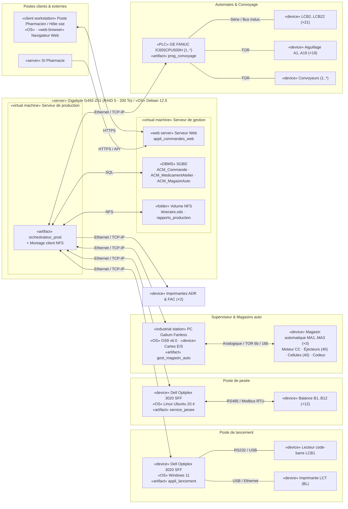

```mermaid
classDiagram
    direction TB

    class Pharmacie {
        -idPharmacie: int
        -nom: String
        -adresse: String
        -telephone: String
        +getAdresse(): String
    }

    class Commande {
        -numCommande: int
        -dateCommande: Date
        -typeCommande: String
        -priorite: int
        -etat: String
        +Commande(num: int, type: String)
        +ajouterLigne(med: Medicament, qte: int): void
        +calculerPoidsTotal(): float
        +estUrgente(): bool
    }

    class LigneCommande {
        -quantiteDemandee: int
        -quantitePreparee: int
        +LigneCommande(med: Medicament, qte: int)
        +getSousTotalPoids(): float
        +getSousTotalPrix(): float
        +estComplete(): bool
    }

    class Medicament {
        -codeCIP: String
        -designation: String
        -codeGeo: String
        -masseUnitaire: float
        -prixUnitaire: float
        -typeConditionnement: String
        +getCodeCIP(): String
        +getMasseUnitaire(): float
        +estEnMagasinAuto(): bool
    }

    class IHM {
        -typeInterface: String
        +saisirCommande(pharm: Pharmacie): Commande
        +programmerRecurrente(pharm: Pharmacie): Commande
        +afficherMessage(msg: String): void
    }

    class RapportProduction {
        -idRapport: int
        -dateGeneration: Date
        -nbCommandesTraitees: int
        -nbErreurs: int
        +generer(): void
        +sauvegarderNFS(chemin: String): bool
    }

    class BonDeLivraison {
        -numeroBL: int
        -dateEdition: Date
        +BonDeLivraison(cmd: Commande)
        +formaterImpression(): String
    }

    class Facture {
        -numeroFacture: int
        -dateFacture: Date
        -montantTotal: float
        +Facture(cmd: Commande)
        +calculerMontant(): float
    }

    class TicketAdresse {
        -nomDestinataire: String
        -adresseLivraison: String
        +TicketAdresse(pharm: Pharmacie)
    }

    class Caisse {
        -codeBarre: String
        -tare: float
        -masseCourante: float
        -masseAttendue: float
        -nbPassagesMSA: int
        -etat: String
        +Caisse(codeBarre: String)
        +tarer(masse: float): void
        +verifierPoids(masseMesuree: float): bool
        +incrementerPassagesMSA(): int
    }

    class Itineraire {
        -idItineraire: int
        -etapeCourante: int
        +Itineraire(cmd: Commande)
        +calculer(): void
        +getEtapeSuivante(): EtapeItineraire
        +sauvegarderNFS(chemin: String): bool
    }

    class EtapeItineraire {
        -numPos: int
        -positionConv: int
        -numLCB: int
        -cmdAiguillage: String
        -poidsPrevu: float
        +EtapeItineraire(pos: int, conv: int, lcb: int, aig: String, poids: float)
        +getPoidsPrevu(): float
    }

    class Imprimante {
        -idImprimante: int
        -poste: String
        +imprimer(contenu: String): bool
    }

    class PosteSemiAuto {
        -idMSA: int
        -disponible: bool
        +estDisponible(): bool
        +signalerFinPreparation(caisse: Caisse): void
    }

    class LecteurCodeBarre {
        -idLCB: int
        -emplacement: String
        +lireCodeBarre(): String
    }

    class Aiguillage {
        -idAiguillage: int
        -position: int
        +orienter(position: int): void
        +getPosition(): int
    }

    class Convoyeur {
        -idConvoyeur: int
        -type: String
        -etatMarche: bool
        +demarrer(): void
        +arreter(): void
        +debrayer(): void
    }

    class Balance {
        -idBalance: int
        -adresseModbus: int
        -dernierPoids: float
        +peser(): float
    }

    class Magasin {
        -idMagasin: int
        -disponible: bool
        +lireCode(code: int): String
        +ejecterMedicament(pos: int, nb: int): int
    }

    class Ejecteur {
        -numero: int
        -stockGoulotte: int
        -etatCellulePhoto: bool
        +ejecter(nb: int): int
        +verifierChute(): bool
    }

    class Tas {
        -positionCourante: int
        -etat: int
        -codeCIP: String[20]
        -quantiteAMettre: int[20]
        +Tas(code: String[200], nb: int[200])
        +majPosition(): int
    }

    class TapisRoulant {
        +TapisRoulant()
        +CreerTas()
        +GererCommandes()
    }

    class FileDeCommande {
        +lireNombre(): int
        +lireCommandeSuivante(): json
    }

    class Codeur {
        -delai: int
        +Codeur(valeur: int)
        +attendreSynchro()
    }

    Commande "*" --> "1" Pharmacie : -client
    Commande "1" *-- "1..*" LigneCommande : -lignes
    LigneCommande "*" --> "1" Medicament : -medicament
    IHM --> "*" Commande : -commandes
    IHM --> "*" Pharmacie : -pharmacies
    RapportProduction "*" --> "*" Commande : -commandes

    BonDeLivraison "0..1" --> "1" Commande : -commande
    Facture "0..1" --> "1" Commande : -commande
    TicketAdresse "*" --> "1" Pharmacie : -destinataire
    BonDeLivraison "*" --> "1" Imprimante : -imprimante
    Facture "*" --> "1" Imprimante : -imprimante
    TicketAdresse "*" --> "1" Imprimante : -imprimante

    Caisse "0..1" --> "1" Commande : -commande
    Caisse "1" --> "0..1" BonDeLivraison : -bl
    Caisse "1" --> "0..1" Facture : -facture
    Caisse "1" --> "0..1" TicketAdresse : -ticket
    Caisse "1" *-- "0..1" Itineraire : -itineraire
    Itineraire "1" *-- "1..*" EtapeItineraire : -etapes

    EtapeItineraire "*" --> "0..1" LecteurCodeBarre : -lcb
    EtapeItineraire "*" --> "0..1" Aiguillage : -aiguillage
    EtapeItineraire "*" --> "0..1" Balance : -balance
    EtapeItineraire "*" --> "1" Convoyeur : -convoyeur

    PosteSemiAuto "*" --> "1" LecteurCodeBarre : -lcb
    PosteSemiAuto "*" --> "1" Balance : -balance
    PosteSemiAuto "*" --> "1" Convoyeur : -convoyeurParallele

    Magasin "1" *-- "40" Ejecteur : -ejecteurs
    Ejecteur "*" --> "0..1" Medicament : -medicament
    Tas "*" --> "1" Magasin : -magasin
    TapisRoulant "1" *-- "*" Tas : -tas[]
    TapisRoulant "1" *-- "1" Codeur : -codeur
    TapisRoulant --> "1" FileDeCommande : -file
    FileDeCommande --> "*" Commande : -commandesEnAttente
```

# R3.03 Analyse — Projet Atelier de conditionnement de médicaments

## Séance 2 : Architecture matérielle, comparaisons technologiques, déploiement et classes

- **Équipe** : Nathan Chaignon, Clément Bazin, Paul Maillard (`NUM = TD1` · `GP = 1C`)
- **Fichier StarUML associé** : [`uml/atelier_conditionnement.mdj`](../uml/atelier_conditionnement.mdj)
- **Référence** : Dossier Technique *Atelier de conditionnement de médicaments* (E. Porcq, V2.4) & `itineraire.ods`

---

## 5-4) Association des objets informatiques aux ordinateurs de l'atelier

Les 24 objets informatiques identifiés en Séance 1 ([`docs/seance1_analyse.md`](seance1_analyse.md)) sont répartis sur les **6 systèmes informatiques** décrits dans les sections 2.2 et 4.1 du dossier technique. Lorsqu'une entité métier intervient à la fois en persistance et en traitement actif (par exemple `Commande` ou `Itineraire`), le tableau distingue explicitement son **hébergement persistant** (base de données ou volume NFS) de son **exécution en mémoire** (orchestration ou impression).

### Tableau de synthèse de la répartition

| Système informatique *(matériel / OS)* | Objets informatiques hébergés ou exécutés | Rôle logiciel sur ce nœud |
| --- | --- | --- |
| **Serveur de gestion** *(VM Debian 12.5 sur Gigabyte G492-Z51, RAID 5 200 To, Serveur Web, SGBD, NFS)* | `Pharmacie`, `Commande` *(persistance)*, `LigneCommande` *(persistance)*, `Medicament` *(référentiel)*, `Itineraire` *(stockage NFS)*, `EtapeItineraire` *(stockage NFS)*, `RapportProduction` *(archivage NFS)*, `IHM` *(application Web & passerelle)* | Stocke les bases `ACM_Commande`, `ACM_MedicamentAtelier` et `ACM_MagasinAuto` ; expose l'application Web (commandes manuelles et récurrentes des pharmaciens, saisie urgente par l'hôte·sse) et l'API de réception des commandes automatiques ; héberge le volume NFS partagé pour les itinéraires et rapports de production. |
| **Serveur de production** *(2ᵉ VM Debian 12.5 sur Gigabyte G492-Z51, client NFS — chef d'orchestre)* | `Commande` *(active)*, `LigneCommande` *(active)*, `Medicament` *(en cours)*, `BonDeLivraison`, `Itineraire` *(calcul)*, `EtapeItineraire` *(calcul)*, `Caisse`, `PosteSemiAuto`, `Facture`, `TicketAdresse`, `RapportProduction` *(génération)*, `Imprimante` *(ADR & FAC)*, `IHM` *(supervision / postes opérateurs)* | Orchestre tout le cycle de conditionnement : lit les commandes en attente et les fiches médicaments sur le serveur de gestion, calcule l'itinéraire et les masses attendues, génère le BL, pilote les caisses via l'API, contrôle les pesées via le poste de pesée, oriente vers MA/MSA/MM/erreur, génère les tickets d'adresse, factures et rapports de production. |
| **Superviseur** *(PC industriel fanless Galium, OS9 v6.0, E/S TOR 6 bits, codeurs 16 bits, sorties tension variable)* | `Magasin` (`MA1`–`MA3`), `Ejecteur` (`3 × 40`), `TapisRoulant` (`×3`), `Tas`, `FileDeCommande` (`×3`), `Codeur` (`×3`) | Pilote en temps réel les 3 magasins automatiques : charge les références CIP depuis `ACM_MagasinAuto`, reçoit les commandes transmises par le serveur de production dans ses files FIFO, synchronise l'avancement des tapis via les codeurs incrémentaux et déclenche/contrôle les 40 éjecteurs par magasin. |
| **Poste de lancement (`LCT`)** *(Dell Optiplex 3020 SFF, Windows 11)* | `BonDeLivraison` *(reçu)*, `Imprimante` *(LCT)*, `LecteurCodeBarre` *(`LCB1` uniquement)*, `Caisse` *(association initiale)*, `IHM` *(poste LCT)* | Reçoit le BL depuis le serveur de production, l'imprime et le dépose dans la caisse ; lit le code-barre initial via `LCB1` et déclenche l'acheminement d'une caisse vide pour démarrer le cycle. |
| **Poste de pesée** *(Dell Optiplex 3020 SFF, Ubuntu 20.4, interface RS485 Modbus)* | `Balance` (`B1`–`B12`) | Sert de passerelle d'acquisition temps réel pour les 12 balances de l'atelier : reçoit les demandes de pesée du serveur de production sur Ethernet, interroge la balance ciblée en Modbus sur RS485 et retourne la masse mesurée. |
| **Automates Programmables Industriels (`API`)** *(GE FANUC IC655CPU500H, plusieurs unités)* | `LecteurCodeBarre` *(`LCB2` à `LCB22`)*, `Aiguillage` (`A1` à `A19`), `Convoyeur` *(principaux, débrayables et parallèles)* | Acquièrent en continu les passages devant les 21 lecteurs `LCB2`–`LCB22` et remontent les identifiants au serveur de production ; exécutent ses ordres en pilotant les moteurs de convoyeurs et l'orientation des 19 aiguillages. |

### Détail et justification du poste de lancement (`?` du dossier technique p. 5)

Le dossier technique indique délibérément *« Le poste de lancement ? »* dans la section **4.2 Le matériel et les protocoles** (p. 5). Par analyse fonctionnelle des sections 2.2 et 3.1, ce poste (Dell Optiplex 3020 SFF sous Windows 11) nécessite nécessairement les interfaces matérielles et protocolaires suivantes :

1. **Une carte Ethernet (TCP/IP)** : indispensable pour recevoir du serveur de production l'ordre de préparation accompagné du `BonDeLivraison` (`BL`) et lui renvoyer en retour le code-barre de la caisse associée lu sur `LCB1`.
2. **Une interface de liaison vers l'imprimante du BL (USB ou Ethernet locale)** : pour imprimer le bon de livraison qui tombe automatiquement dans la caisse.
3. **Une interface série RS232 ou USB (émulation port COM / HID) vers `LCB1`** : le poste de lancement lit un **seul** lecteur de code-barre à courte distance (`LCB1` est explicitement exclu de l'API p. 3), ce qui correspond exactement à une liaison point-à-point RS232 ou USB.
4. **Pilotage de l'acheminement d'une caisse vide** : soit par message réseau via le serveur de production/API, soit par une sortie TOR dédiée commandant le distributeur de caisses vides jusqu'au poste de lancement.

---

## 5-6) Explications et comparaisons technologiques

### 1. Liaison série `RS232` vs `RS485`

- **`RS232`** est une norme de communication série **asymétrique** (signaux référencés par rapport à une masse commune) conçue pour des liaisons **point-à-point** (1 émetteur, 1 récepteur) sur de courtes distances (≤ 15 m).
- **`RS485`** (TIA/EIA-485) est une couche physique série **différentielle** (deux fils torsadés `A`/`B` transmettant des tensions opposées) conçue pour un bus **multipoint** en milieu industriel bruité.

| Critère | `RS232` | `RS485` |
| --- | --- | --- |
| **Mode de transmission** | Asymétrique (référencé à la masse) | Différentiel (paire torsadée `A`/`B`) |
| **Topologie** | Point-à-point (1 ↔ 1) | Bus multipoint (jusqu'à 32 charges unitaires, ou 128–256 selon transceivers) |
| **Distance maximale** | ~15 m | Jusqu'à **1 200 m** (à débit réduit) |
| **Débit maximal** | ~20–115,2 kbit/s | Jusqu'à 10 Mbit/s sur courte distance (~100 kbit/s à 1 200 m) |
| **Immunité aux parasites (CEM)** | Faible | **Élevée** (réjection en mode commun du bruit industriel) |
| **Duplex** | Full-duplex (TX et RX séparés) | Half-duplex sur 2 fils (le plus courant) ou Full-duplex sur 4 fils |

**Choix justifié dans l'atelier** : les **12 balances (`B1`–`B12`)** sont réparties dans tout l'atelier à proximité des moteurs de convoyeurs (fortes perturbations électromagnétiques) et dépassent largement 15 m de câblage depuis le poste de pesée. Le bus **`RS485`** (cf. Annexe 2, p. 9) permet de chaîner les 12 balances sur un unique câble différentiel fiable jusqu'au poste de pesée. En revanche, une liaison **`RS232`** (ou USB) suffit pour un périphérique unique proche d'un PC comme `LCB1` au poste de lancement.

---

### 2. Partage de fichiers réseau `NFS` vs `SMB`

- **`NFS` (*Network File System*)** est le protocole standard de système de fichiers distribué dans l'écosystème Unix/Linux (basé sur RPC/TCP).
- **`SMB` (*Server Message Block*, aussi appelé CIFS / Samba sous Linux)** est le protocole de partage réseau natif de Microsoft Windows.

| Critère | `NFS` (v3 / v4) | `SMB` (v2 / v3) |
| --- | --- | --- |
| **Écosystème natif** | Unix / Linux / POSIX | Microsoft Windows (interopérable Linux via Samba) |
| **Sémantique fichiers** | Droits POSIX natifs (`uid`/`gid`, liens symboliques) | ACL Windows (NTFS), verrous opportunistes |
| **Surcharge protocole** | Faible, montage direct dans l'arborescence VFS Linux | Plus verbeux, négociations de session et d'authentification AD/NTLM |
| **Sécurité** | Contrôle IP/export (v3) ou Kerberos/TLS (v4) | Authentification utilisateur/domaine et chiffrement intégrés (SMBv3) |
| **Performance Linux ↔ Linux** | Excellente sur petits et moyens fichiers en LAN | Légèrement inférieure à NFS entre hôtes POSIX purs |

**Choix justifié dans l'atelier** : le serveur de gestion et le serveur de production sont deux machines virtuelles tournant sous **Debian 12.5** sur le même hôte physique Gigabyte. L'usage d'un **volume `NFS`** (p. 5 §4.2) est le choix naturel, performant et sans couche d'adaptation (pas de Samba à maintenir) pour permettre au serveur de production de déposer directement les itinéraires et les rapports de production. `SMB` n'aurait de sens que si le poste de lancement sous **Windows 11** devait monter un partage réseau bureautique depuis le serveur.

---

### 3. `Ethernet` vs `Modbus` *(distinction de couches OSI)*

Comparer `Ethernet` et `Modbus` nécessite d'abord de lever une ambiguïté fondamentale : **ils n'opèrent pas au même niveau du modèle OSI** et sont donc complémentaires plutôt que strictement concurrents :

- **`Ethernet` (IEEE 802.3)** définit les couches **1 (Physique)** et **2 (Liaison de données — trames MAC, CSMA/CD ou commutation full-duplex)**. Il sert de socle au transport IP/TCP/UDP sur réseau local (100 Mbit/s, 1 Gbit/s, 10 Gbit/s).
- **`Modbus`** est un protocole **applicatif (couche 7)** de type **Maître/Esclave** (Client/Serveur sur TCP) très simple, dédié à la lecture/écriture de registres et bits industriels (coils, holding registers). Il peut s'appuyer sur **RS485** (**Modbus RTU/ASCII**) ou sur **Ethernet TCP/IP** (**Modbus TCP** sur le port 502).

| Critère | `Ethernet` (IEEE 802.3) | `Modbus` (RTU sur RS485 / TCP) |
| --- | --- | --- |
| **Niveau OSI** | Couches **1 et 2** (réseau local généraliste) | Couche **7** (protocole applicatif industriel) |
| **Modèle d'échange** | Pair-à-pair, multidiffusion, supporte tous protocoles (HTTP, NFS, SQL, Modbus TCP…) | **Maître / Esclave** strict (le maître interroge chaque esclave par adresse) |
| **Débit typique** | 100 Mbit/s à 10 Gbit/s+ | 9,6 à 115,2 kbit/s en RTU (ou débit Ethernet en Modbus TCP) |
| **Déterminisme** | Non déterministe par défaut (commutation, collisions/files) | Déterministe en scrutation maître/esclave sur RS485 |
| **Usage type** | Dorsale informatique, serveurs, Web, bases de données, API | Capteurs, balances industrielles, variateurs, automates simples |

**Choix justifié dans l'atelier** : l'architecture combine les deux technologies là où chacune excelle :
- **Dorsale `Ethernet`** pour interconnecter le serveur de gestion/production, les postes Windows/Ubuntu, le superviseur OS9 et les API GE FANUC (flux riches : SQL, HTTP, NFS, commandes applicatives).
- **Protocole `Modbus` sur bus `RS485`** (p. 5 §4.2) entre le poste de pesée et les **12 balances (`B1`–`B12`)** : chaque balance possède une adresse esclave unique, et le poste de pesée (maître) lui demande une mesure sur requête explicite sans encombrer le réseau IP avec 12 équipements série de terrain.

---

### 4. `API` (Automate Programmable Industriel) vs `PC`

- **`API` (PLC)** : calculateur industriel durci exécutant de façon cyclique et déterministe (scrutation entrées → traitement logique → mise à jour sorties) un programme temps réel (Grafcet, Ladder, Texte Structuré).
- **`PC` (Personnel ou Industriel)** : architecture polyvalente (x86/ARM) dotée d'un système d'exploitation généraliste (Windows, Linux) ou temps réel (OS9 sur PC industriel), riche en mémoire, stockage et connectivité réseau/IHM.

| Critère | `API` *(ex. GE FANUC IC655CPU500H)* | `PC` *(ex. Dell Optiplex / Serveur / Galium)* |
| --- | --- | --- |
| **Temps réel & déterminisme** | **Temps réel dur cyclique** (temps de cycle garanti en ms) | OS bureautique non temps réel (Windows/Ubuntu) ; temps réel uniquement avec OS dédié (**OS9** sur PC industriel) |
| **Robustesse environnementale** | Durci (chocs, poussière, 24 V CC, fonctionnement continu sans disque mécanique) | Sensible sur PC standard ; nécessite version *fanless* durcie en atelier |
| **Entrées / Sorties terrain** | Natives (TOR 24 V, comptage rapide, relais, bus terrain) | Nécessite cartes d'extension dédiées ou passerelles (ex. cartes E/S du Galium, adaptateur RS485) |
| **Puissance de calcul, BDD & IHM** | Limitée (peu adapté au SQL, HTTP ou calcul d'itinéraire complexe) | **Élevée** (SGBD, virtualisation, serveur Web, IHM graphiques) |
| **Démarrage et maintenance** | Instantané, reprise sur coupure très fiable | Boot plus long, mises à jour OS, risques logiciels plus élevés |

**Choix justifié dans l'atelier** : chaque rôle est confié au matériel adapté :
- Les **`API` GE FANUC** gèrent le pilotage bas niveau déterministe et rapide sur le terrain (**21 lecteurs `LCB2`–`LCB22`, 19 aiguillages `A1`–`A19` et les convoyeurs**).
- Les **PC et serveurs** portent la logique métier lourde, les bases de données, l'interface Web et le poste de lancement/pesée.
- Le **Superviseur** illustre le compromis intermédiaire : un **PC industriel fanless Galium** sous système temps réel **OS9** muni de cartes d'E/S matérielles, capable à la fois de gérer des files JSON/SQL (`FileDeCommande`, `Tas`) et de piloter en temps réel 3 × 40 éjecteurs et 3 codeurs incrémentaux.

---

### 5. `Codeur optique incrémental` vs `Codeur optique absolu`

- **`Codeur incrémental`** : disque optique comportant des pistes régulières (voies `A` et `B` en quadrature pour détecter sens et pas, plus éventuellement un top zéro `Z` par tour). Il émet des **impulsions relatives** proportionnelles au déplacement.
- **`Codeur absolu`** : disque multi-pistes (codage binaire ou code de Gray) attribuant un **mot numérique unique à chaque position angulaire** (monotour ou multitour).

| Critère | `Codeur incrémental` | `Codeur absolu` |
| --- | --- | --- |
| **Information délivrée** | Impulsions relatives (`Δposition`) + sens | Position numérique absolue immédiate |
| **Mémoire après coupure secteur** | **Perdue** (nécessite une prise d'origine / réinitialisation) | **Conservée** dès la remise sous tension |
| **Câblage / Interface** | Simple (2 à 3 signaux + comptage sur carte 16 bits) | Plus complexe (bus parallèle `n` bits ou bus série SSI / BiSS / CANopen) |
| **Coût et robustesse mécanique** | **Économique**, disque simple à haute résolution | Plus coûteux et plus fragile (nombreuses pistes optiques) |

**Choix justifié dans l'atelier** : sur les magasins automatiques (`MA1`–`MA3`), le tapis roulant de **60 m** avance toujours dans le même sens en continu et est cadencé par **pas réguliers** entre deux positions d'éjecteurs (cf. `Codeur.attendreSynchro()` qui bloque l'exécution le temps que le tapis parcoure exactement l'espacement entre deux positions). Une mesure absolue sur un seul tour n'apporterait rien sur un tapis de 60 m (il faudrait un multitour onéreux), et en cas d'arrêt d'urgence les tas physiques sont vidés/repris. Le **codeur optique incrémental** est donc plus simple, moins cher et parfaitement adapté à la synchronisation pas-à-pas sur les entrées 16 bits du superviseur.

---

### 6. `RAID 1` vs `RAID 5`

- **`RAID 1` (Mirroring)** : duplication intégrale des données à l'identique sur au moins 2 disques.
- **`RAID 5` (Striping avec parité distribuée)** : découpage des données en bandes (*stripes*) réparties sur au moins 3 disques, avec calcul d'un bloc de parité (`XOR`) distribué sur l'ensemble des disques.

| Critère | `RAID 1` | `RAID 5` |
| --- | --- | --- |
| **Nombre minimal de disques** | 2 disques | **3 disques** |
| **Capacité utile ($N$ disques de taille $T$)** | $50\,\%$ ($T$ pour 2 disques) | **$\frac{N - 1}{N}$** (ex. $75\,\%$ avec 4 disques, $83\,\%$ avec 6 disques) |
| **Tolérance aux pannes** | 1 disque perdu (dans une paire) | **1 disque perdu** quel qu'il soit |
| **Performances lecture / écriture** | Lecture rapide, écriture = $1\times$ | Lecture très rapide (parallèle), **pénalité en écriture** (lecture-modification-écriture de la parité) |
| **Risque à la reconstruction** | Simple recopie rapide du miroir | Reconstruction longue et stressante pour les disques restants sur de très gros volumes (risque de double panne / URE) |

**Choix justifié dans l'atelier** : le serveur physique Gigabyte G492-Z51 doit fournir **200 To utiles** (p. 5 §4.2) pour héberger les VM, les bases `ACM_*`, les itinéraires et l'historique des rapports de production. En `RAID 1`, 200 To utiles exigeraient **400 To bruts** (coût matériel doublé), alors que le **`RAID 5`** n'immobilise que la capacité d'un seul disque pour la parité. Il offre donc le meilleur compromis capacité/coût/disponibilité pour ce volume de stockage, tout en rappelant que **le RAID assure la continuité de service mais ne remplace jamais une sauvegarde externe**.

---

## 5-7) Diagramme de déploiement du système

Le diagramme de déploiement complet se trouve dans [`uml/atelier_conditionnement.mdj`](../uml/atelier_conditionnement.mdj) (modèle **`2) Déploiement`** → **`Déploiement - Atelier de conditionnement`**).

### Choix de modélisation (conformément au cours `R201_UML2.pdf` et à `prepaTD8B.pdf`)

- **Nœuds matériels (`«server»`, `«industrial station»`, `«PLC»`, `«client workstation»`, `«device»`)** et **environnements d'exécution imbriqués (`«OS»`, `«virtual machine»`, `«web server»`, `«DBMS»`, `«web browser»`, `«folder»`)** :
  - L'hôte physique **`Gigabyte G492-Z51`** (`«server»`, `RAID 5 - 200 To`) exécute **`Debian 12.5`** (`«OS»`), qui héberge les deux machines virtuelles **`Serveur de gestion`** et **`Serveur de production`** (`«virtual machine»`).
  - Sur le `Serveur de gestion` sont déployés le serveur Web (`«web server»`), le SGBD (`«DBMS»`) contenant les trois bases (`«database» ACM_Commande`, `ACM_MedicamentAtelier`, `ACM_MagasinAuto`), et le **`Volume NFS`** (`«folder»`) stockant les itinéraires (`itineraire.ods`) et les rapports de production.
  - Le `Serveur de production` embarque l'orchestrateur (`«artifact» orchestrateur_prod`) et le point de montage client NFS communiquant directement avec le `Volume NFS` (`NFS`) et le `SGBD` (`SQL`).
- **Distinction liaisons physiques vs protocoles logiques** :
  - Connexions LAN générales annotées **`Ethernet / TCP-IP`** vers le `Poste de lancement`, le `Poste de pesée`, le `Superviseur`, les `API GE FANUC` (`1..*`) et les imprimantes `ADR` et `FAC`.
  - Connexions logiques entre environnements d'exécution/artefacts annotées par leur protocole : **`HTTPS`** (navigateur ↔ serveur Web), **`HTTPS / API`** (SI pharmacie ↔ serveur Web), **`SQL`** et **`NFS`** (serveur de production ↔ serveur de gestion).
  - Connexions terrain annotées par bus et signalisation : **`RS485 / Modbus RTU`** (`Poste de pesée` → `12` balances), **`RS232 / USB`** (`Poste de lancement` → `LCB1`), **`USB / Ethernet`** (`Poste de lancement` → `Imprimante LCT`), **`TOR / Entrées-Sorties`** (cartes E/S du `Superviseur` vers les `3` magasins automatiques : analogique moteur CC, TOR 6 bits éjecteurs & cellules, 16 bits codeur incrémental ; `API` vers `21` LCB, `19` aiguillages et `1..*` convoyeurs).

### Aperçu schématique (Mermaid)

---

## 5-5) Diagramme de classes du système

Le diagramme de classes complet est modélisé dans [`uml/atelier_conditionnement.mdj`](../uml/atelier_conditionnement.mdj) (modèle **`3) Diagramme de classes`** → **`Diagramme de classes - Système de conditionnement`**).

> *Conformité avec la démarche du cours (`R303_UML9.pdf`, p. 16)* : ce diagramme constitue une **conception complète V1** couvrant l'ensemble des **24 classes** de `5-3`. Il intègre **sans aucune altération** le sous-modèle imposé par le dossier technique p. 7 pour les magasins automatiques, et sera validé puis affiné lors des diagrammes de séquence des Séances 3 (`5-8`) et 4 (`5-9`).

### Choix de modélisation et justifications précises

1. **Conformité aux conventions UML du cours (E. Porcq)** :
   - **Pas de redondance attribut / rôle** (`R201_UML3.pdf`, p. 18) : lorsqu'une classe détient une référence vers une autre classe via une association navigable dotée d'un nom de rôle (ex. `-magasin`, `-tas[]`, `-client`, `-lignes`), ce lien n'est pas dupliqué dans le compartiment des attributs.
   - **Rôles systématiques et navigabilité explicite** : toutes les associations utiles portent leurs rôles, leurs multiplicités et leur flèche de navigabilité.
2. **Gestion des commandes et résolution N:N (`Commande` – `LigneCommande` – `Medicament`)** :
   - Une commande regroupe plusieurs médicaments et un même médicament apparaît dans de nombreuses commandes. La classe **`LigneCommande`** matérialise l'association porteuse d'attributs (`quantiteDemandee`, `quantitePreparee`) dans une composition `Commande (1)` ◆──`-lignes (1..*)`──▶ `LigneCommande`, chaque ligne pointant vers un `Medicament` (`-medicament (1)`).
   - La relation `Commande (*)` ──`-client (1)`──▶ `Pharmacie` rattache chaque commande à sa pharmacie destinataire (`nom`, `adresse`, `telephone`).
   - `IHM` interagit avec `Pharmacie` et `Commande` pour la saisie/programmation des commandes ; `RapportProduction` référence les `Commande` traitées pour générer les bilans sauvegardés sur NFS.
3. **Traçabilité physique et documentaire (`Caisse`, `BonDeLivraison`, `Facture`, `TicketAdresse`, `Itineraire`)** :
   - Chaque `Caisse` en circulation (identifiée par `codeBarre` unique) porte ses mesures (`tare`, `masseCourante`, `masseAttendue`, `nbPassagesMSA`, `etat`) et référence le `BonDeLivraison` (`0..1`), la `Facture` (`0..1`) et le `TicketAdresse` (`0..1`) associés.
   - `BonDeLivraison`, `Facture` et `TicketAdresse` pointent chacun vers l'`Imprimante` chargée de leur impression (`LCT`, `FAC`, `ADR`), et dépendent des données de `Commande` / `Pharmacie`.
   - `Itineraire` est composé (`◆`) d'une suite ordonnée de `1..*` **`EtapeItineraire`**, dont les attributs (`numPos`, `positionConv`, `numLCB`, `cmdAiguillage`, `poidsPrevu`) reflètent exactement la structure du fichier officiel **`itineraire.ods`**.
4. **Équipements de convoyage, pesée et postes semi-automatiques** :
   - Chaque équipement matériel piloté ou interrogé (`LecteurCodeBarre`, `Aiguillage`, `Convoyeur`, `Balance`, `Imprimante`) possède sa propre classe logicielle image avec ses identifiants et opérations primitives (`lireCodeBarre()`, `orienter()`, `demarrer()`/`arreter()`/`debrayer()`, `peser()`, `imprimer()`).
   - `PosteSemiAuto` (`MSA1`–`MSA8`) agrège/référence ses équipements dédiés : `1` `LecteurCodeBarre` (`-lcb`), `1` `Balance` (`-balance`) et `1` `Convoyeur` parallèle (`-convoyeurParallele`).
   - `Caisse` peut être lue par `LecteurCodeBarre` et pesée par `Balance` lors de son parcours défini par `Itineraire`.
5. **Intégration stricte du sous-modèle imposé des magasins automatiques (Dossier Technique p. 7)** :
   - Les 5 classes **`Magasin`**, **`TapisRoulant`**, **`Tas`**, **`FileDeCommande`** et **`Codeur`** conservent **exactement** leurs noms, attributs, méthodes, types, visibilités, rôles et compositions imposés :
     - `TapisRoulant (1)` ◆──`-tas[] (*)`──▶ `Tas`
     - `TapisRoulant (1)` ◆──`-codeur (1)`──▶ `Codeur`
     - `TapisRoulant` ──`-file`──▶ `FileDeCommande`
     - `Tas (*)` ──`-magasin (1)`──▶ `Magasin`
   - *Note de fidélité sur `Tas`* : le dossier technique p. 7 déclare `-codeCIP: String[20]` / `-quantiteAMettre: int[20]` en attributs mais `+Tas(code: String[200], nb: int[200])` en constructeur. Cet écart typographique du sujet d'origine est volontairement conservé à l'identique afin de garantir une conformité stricte avec la question `5-9`.
   - Extension cohérente vers l'atelier : `Magasin (1)` ◆──`-ejecteurs (40)`──▶ `Ejecteur` modélise les 40 rails/éjecteurs par magasin automatique, chaque `Ejecteur` référençant le `Medicament` (`0..1`) stocké dans sa goulotte (`stockGoulotte`, `etatCellulePhoto`). `FileDeCommande` maintient l'ordre des `Commande` transmises au magasin.

### Récapitulatif des 24 classes par domaine

| Domaine | Classes |
| --- | --- |
| **Commandes, catalogue & pilotage IHM** (6) | `Pharmacie`, `Commande`, `LigneCommande`, `Medicament`, `IHM`, `RapportProduction` |
| **Documents, caisse & itinéraire** (6) | `BonDeLivraison`, `Facture`, `TicketAdresse`, `Caisse`, `Itineraire`, `EtapeItineraire` |
| **Convoyage, pesée & postes** (6) | `LecteurCodeBarre`, `Aiguillage`, `Convoyeur`, `Balance`, `PosteSemiAuto`, `Imprimante` |
| **Magasins automatiques (p. 7 + éjecteurs)** (6) | `Magasin`, `Ejecteur`, `TapisRoulant`, `Tas`, `FileDeCommande`, `Codeur` |

### Aperçu schématique (Mermaid)

